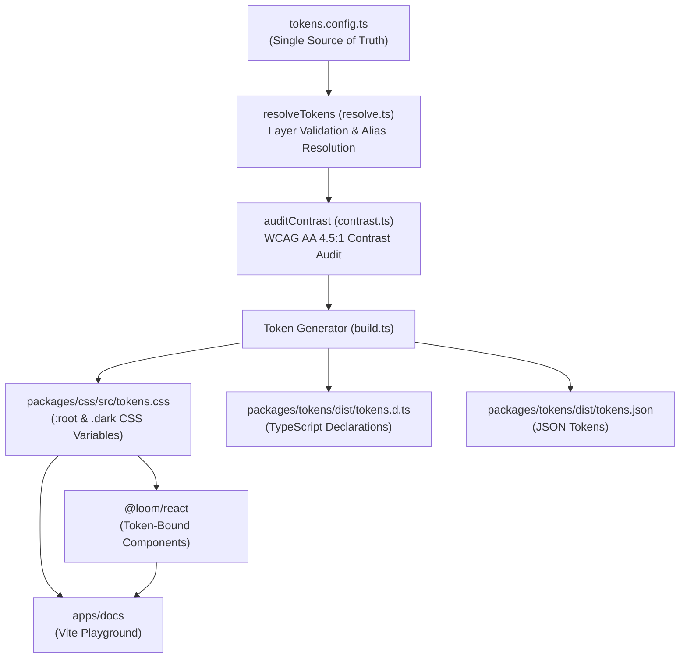
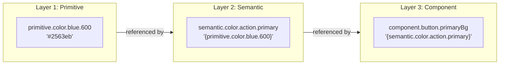

# Loom

> Weaving tokens into components.

[](https://github.com/tarunagnihotri534/Loom/actions/workflows/ci.yml)
[](./LICENSE)
[](https://www.typescriptlang.org/)

---

## Overview

Loom is an open-source, token-first design system built as a TypeScript monorepo. A single configuration file (`tokens.config.ts`) serves as the immutable single source of truth for all design decisions across the entire system. From this single source, CSS custom properties, TypeScript definitions, JSON schemas, and React components are automatically generated, validated, and tested. The system enforces strict layer boundaries and WCAG AA contrast compliance at build time, ensuring that design integrity is guaranteed before code reaches production.

---

## Features

- **3-Tier Token Hierarchy**: Strict layering (Primitive -> Semantic -> Component) with automated compile-time layer boundary enforcement.
- **Build-Time WCAG AA Contrast Audit**: Computes relative luminance and verifies a minimum 4.5:1 contrast ratio for all text/background pairs across light and dark modes.
- **First-Class Dark Mode**: Automatically outputs `:root` and `.dark` CSS custom properties from semantic mode definitions.
- **Accessible React Components**: `Button`, `Input`, and `Card` components built strictly with Loom tokens, supporting keyboard navigation, visible focus styles, and ARIA attributes.
- **Automated Drift Check**: CI fails if committed generated tokens differ in any way from a fresh build.
- **AI Agent Guardrails**: Includes `AGENTS.md` specifying mandatory rules that prevent AI coding agents from hardcoding design values.
- **Optional Docker Support**: Multi-stage containerization with an unprivileged Nginx documentation server and reproducible CI testing.

---

## Architecture

### Build Pipeline



### Token Layer Hierarchy

Loom strictly enforces a three-tier token hierarchy. A layer may only reference tokens from the layer immediately below it. Lateral references within the same layer or bypasses across layers cause immediate build failure.



| Layer | Purpose | Reference Rules | Real Config Example |
| :--- | :--- | :--- | :--- |
| **1. Primitive** (`primitive.*`) | Raw literal values (hex colors, rem values, curves) | None. Must NOT contain `{...}` alias syntax. | `primitive.color.blue.600: "#2563eb"` |
| **2. Semantic** (`semantic.*`) | Roles and intent across light and dark modes | May **only** reference `primitive.*`. | `semantic.color.action.primary: "{primitive.color.blue.600}"` |
| **3. Component** (`component.*`) | Component-specific property bindings | May **only** reference `semantic.*`. Bypassing to primitive is forbidden. | `component.button.primaryBg: "{semantic.color.action.primary}"` |

### Monorepo Structure

```
loom/
├── apps/
│   └── docs/          # Vite + React playground showcasing tokens and components
├── packages/
│   ├── css/           # CSS reset, utilities, and generated tokens.css (:root and .dark)
│   ├── react/         # Accessible React components (Button, Input, Card) built with tokens
│   └── tokens/        # Single source of truth (tokens.config.ts), resolver, and WCAG audit
├── .github/workflows/ # GitHub Actions CI workflows for native and Docker validation
├── AGENTS.md          # Architecture constraints and rules for AI coding agents
├── Dockerfile         # Multi-stage container definition (base, deps, build, docs)
├── docker-compose.yml # Docker Compose services for dev, test, and drift checks
├── package.json       # Monorepo root scripts and dev dependencies
├── pnpm-workspace.yaml# Workspace package definitions and pnpm configuration
└── turbo.json         # Turborepo task pipeline configuration
```

### Token Engine Implementation

The token engine is written in pure TypeScript in `packages/tokens/src/`:
- **Alias Resolution and Layer Rules** (`packages/tokens/src/resolve.ts`): Parses nested token trees and resolves `{path.to.token}` alias strings. It verifies that primitive tokens contain only literal values, semantic tokens reference only primitive tokens, and component tokens reference only semantic tokens. Broken references, circular aliases, or layer violations throw descriptive exceptions that halt the build.
- **WCAG AA Contrast Audit** (`packages/tokens/src/contrast.ts`): Computes relative luminance ($L = 0.2126 R + 0.7152 G + 0.0722 B$ after sRGB channel linearization) and calculates contrast ratios for all configured foreground and background pairs in both light and dark modes. If any pair falls below the 4.5:1 ratio, the build fails with a diagnostics list detailing the failing pairs, colors, and calculated values.
- **Artifact Generator** (`packages/tokens/src/build.ts`): Executes the resolution and contrast audit pipelines, formatting valid tokens into `:root` and `.dark` CSS variables in `packages/css/src/tokens.css`, TypeScript declarations in `packages/tokens/dist/tokens.d.ts`, and structured token trees in `packages/tokens/dist/tokens.json`.

---

## Quick Start

### Prerequisites
- Node.js >= 20.0.0
- pnpm >= 11.0.0

### Setup and Build
Run each command in sequence (supported in both PowerShell and bash):

```bash
pnpm install
pnpm run build
pnpm run test
pnpm run dev
```

The documentation playground will start locally at `http://localhost:3000`.

---

## Usage

### 1. Import CSS Tokens and Styles

Import the reset, generated tokens, utilities, and component styles in your application root:

```tsx
import "@loom/css";
import "@loom/react/styles.css";
```

### 2. Use React Components

All components consume Loom CSS variables automatically:

```tsx
import React, { useState } from "react";
import { Button, Input, Card } from "@loom/react";

export function FeedbackCard() {
  const [comment, setComment] = useState("");
  const [submitted, setSubmitted] = useState(false);

  return (
    <Card interactive onClick={() => console.log("Card selected")}>
      <h3 style={{ margin: "0 0 var(--loom-spacing-2) 0" }}>Project Feedback</h3>
      <Input
        placeholder="Enter your feedback..."
        value={comment}
        onChange={(e) => setComment(e.target.value)}
        invalid={comment.length > 0 && comment.length < 5}
      />
      <div style={{ marginTop: "var(--loom-spacing-4)", display: "flex", gap: "var(--loom-spacing-2)" }}>
        <Button
          variant="primary"
          disabled={comment.length < 5}
          onClick={() => setSubmitted(true)}
        >
          {submitted ? "Submitted" : "Submit"}
        </Button>
        <Button variant="subtle" onClick={() => setComment("")}>
          Clear
        </Button>
      </div>
    </Card>
  );
}
```

---

## Workspace Scripts

The following scripts are defined in the root `package.json`:

| Script | Command | Description |
| :--- | :--- | :--- |
| `build` | `turbo run build` | Builds all packages (`tokens`, `css`, `react`, and `docs`) |
| `test` | `turbo run test` | Runs the complete Vitest test suite across all packages |
| `dev` | `turbo run dev` | Launches the documentation playground development server |
| `check:generated` | `turbo run build && git diff --exit-code packages/css/src/tokens.css` | Rebuilds tokens and verifies committed CSS variables match fresh output |
| `docker:build` | `docker compose build` | Builds the multi-stage Docker images |
| `docker:dev` | `docker compose up dev` | Runs the docs playground inside a container with hot reloading on port 3000 |
| `docker:test` | `docker compose run --rm test` | Executes the build and test suite inside an isolated Linux container |
| `docker:check` | `docker compose run --rm check` | Executes the token drift check inside an isolated container |

---

## Docker Support

Docker support is provided as an **optional** workflow for containerized execution and CI parity:

```bash
pnpm run docker:build
pnpm run docker:dev
pnpm run docker:test
pnpm run docker:check
```

> **Testing Note**: Docker CLI was not installed on the local Windows host used during development, so Docker commands have not been executed locally. The configuration uses standard Alpine/Node/Nginx images and is validated through the `docker-check` job in GitHub Actions.

---

## Quality Guarantees

- **Contrast Audit**: 18 critical foreground and background color combinations are checked across light and dark modes during every build. Every pair exceeds the 4.5:1 WCAG AA threshold.
- **Drift Check**: Automated `check:generated` prevents drift between hand-committed CSS and the single source of truth in `tokens.config.ts`.
- **Test Coverage**: 23 automated tests pass across 5 test suites:
  - `@loom/tokens`: 9 tests covering 3-tier layer validation, invalid alias rejection, relative luminance calculations, and contrast failure handling.
  - `@loom/react`: 14 tests covering `Button`, `Input`, and `Card` rendering, click and keyboard activations (`Space` and `Enter`), disabled state suppression, and ARIA attributes.

---

## Known Limitations

- **Interactive Card Nesting**: An interactive `Card` renders with `role="button"` and keyboard triggers; per HTML and WAI-ARIA standards, interactive cards should not contain nested buttons or links.
- **Audit Scope**: The contrast audit verifies an explicit list of design pairs defined in `tokens.config.ts`. Arbitrary custom pairings outside this list are not dynamically verified at compile time.
- **Local Docker Verification**: Docker commands have not been verified on this specific development host due to the absence of the Docker engine; CI executes this in a Linux container.

---

## Roadmap

The following capabilities are planned for future phases:

- [ ] Modal / Dialog component
- [ ] Tabs component
- [ ] Toast notification system
- [ ] Automated palette generator
- [ ] Tailwind CSS preset export
- [ ] Token architecture linter
- [ ] Figma Tokens Studio bidirectional sync

---

## Contributing

Contributions are welcome. Please ensure that all changes adhere to `AGENTS.md`:
1. Modify design tokens only in `packages/tokens/src/tokens.config.ts`.
2. Do not edit generated files (`packages/css/src/tokens.css` or `dist/` files) directly.
3. Run `pnpm run build`, `pnpm run test`, and `pnpm run check:generated` before submitting changes.

---

## License

This project is licensed under the [MIT License](./LICENSE).
